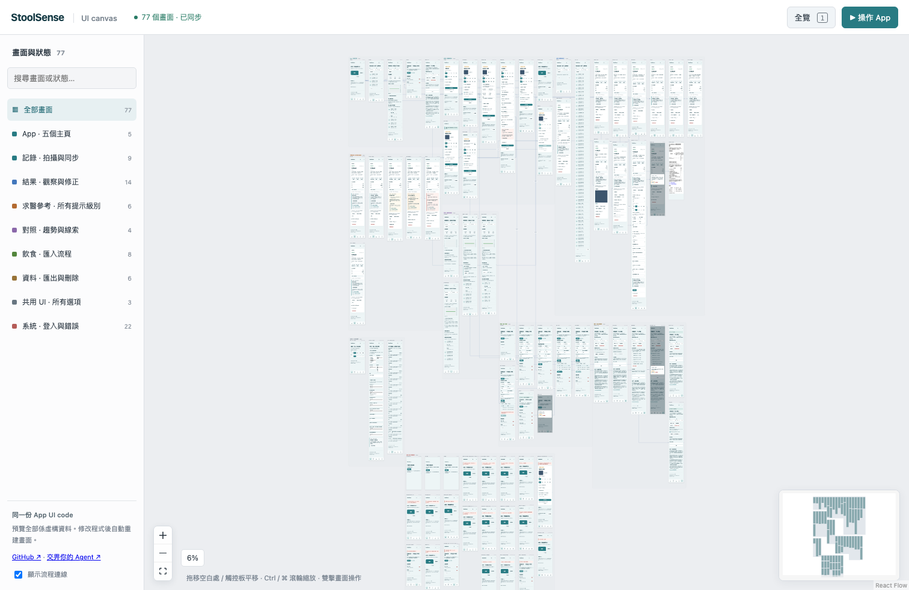

# App Canvas

A zoomable overview of your real application pages, named states and flows. Double-click a screen to use the real UI, then reset its disposable data.

**[Play with the hosted StoolSense canvas →](https://tombelieber.github.io/app-canvas/)**
No install, login or API key. Explore **77 named states**, labeled flows and
working recording/editing/import/export interactions using synthetic data.



One runtime serves multiple projects. Each project keeps its **screen catalog, preview adapter, synthetic fixtures and interaction checks**. Components, layouts and CSS come from the application. There is no second design file to synchronize.

## Give this to your coding agent

Open your application repository in your agent and paste:

```text
Read https://github.com/tombelieber/app-canvas/blob/main/AGENT_GUIDE.md
and add App Canvas to this repository. Inventory all pages, meaningful UI
states, shared controls and flows. Use the actual application code and CSS,
with isolated synthetic fixtures. Deliver a working canvas, missing-page
checks and verified interactions; report counts and any remaining omissions.
```

The [agent guide](AGENT_GUIDE.md) contains installation, integration, coverage,
verification and ongoing maintenance steps. The bundled [React/Vite example](examples/react-vite)
is a runnable reference. It does not require Figma or a particular AI vendor.
An agent that can inspect/edit code and run commands can follow the guide;
Codex and Claude Code also have a bundled skill installer.

## Try the included application

Requires Node.js 22+ and Chromium installed through Playwright. The UI chrome currently uses Traditional Chinese; project screen titles can use any language.

```sh
npm install -g github:tombelieber/app-canvas#v0.2.0
app-canvas browsers
app-canvas demo
```

Open <http://127.0.0.1:6106>. The bundled StoolSense example contains **77 authored cases** from a real recording app, with synthetic records. Recording, correction, deletion, import, export, navigation and dialogs work locally. It makes no AI calls and needs no account.

The example is a frozen frontend export. In a live project the adapter imports current application code; the source watcher rebuilds the overview. Changing this frozen example does not modify the original application.

The hosted demo also uses this frozen synthetic export. It has no application
backend, production session, real health records, AI requests or analytics.
Saving and deleting affect only the disposable browser preview. GitHub Pages
serves the static files under GitHub's own hosting policies.

## Connect a project

Install the agent skill once, then invoke `$app-canvas` in the target repository:

```sh
app-canvas install --target both
```

Targets: `codex`, `claude`, or `both` (default). Existing unmanaged or edited skills are preserved. The canonical skill lives in [tomstack](https://github.com/tombelieber/tomstack/tree/main/skills/engineering/app-canvas); this package includes an installer compatibility snapshot.

For manual integration, start with `canvas.config.mjs`:

```js
export default {
  title: "My app",
  port: 6107,
  groups: [{ id: "pages", title: "Pages" }],
  catalog: [
    {
      id: "home",
      group: "pages",
      title: "Home",
      path: "/",
      source: "src/pages/Home.tsx",
      viewport: { width: 390, height: 844 },
    },
  ],
  flows: [], // { from: 'home', to: 'detail', label: 'Open item' }
  watchPaths: ["src", "ui-review"],
  preview: (ctx) =>
    ctx.createVitePreview({
      appRoot: ".",
      entry: "/ui-review/frame.tsx",
      // Add preview-only SDK aliases and synthetic environment values here.
    }),
};
```

The Vite adapter uses the host project's Vite, aliases, plugins and CSS pipeline. Its preview entry imports the actual app or actual page/provider composition. Inject data at existing dependency boundaries. Do not copy the UI into fixtures. The [StoolSense adapter](examples/stoolsense/canvas.config.mjs) also demonstrates a custom non-Vite renderer.

```js
// In a Vite preview entry, BEFORE importing application modules:
import {
  installPreview,
  ready,
  failed,
  readScenario,
} from "virtual:app-canvas-preview";

const scenario = readScenario(catalog, { key: "my-app" });
installPreview({ handleFetch: syntheticTransport });
// Render the real UI with synthetic identity and API/SDK dependencies.
// Call ready() after the selected case settles; call failed(error) on failure.
```

The transport returns a `Response` for known requests. Unknown fetch requests are rejected and make verification fail. Mock SDK clients separately if your app uses them. The Vite preview sets a local-only resource policy and does not read application `.env` files. Run previews with synthetic data and providers. A custom renderer owns its own transport and resource isolation.

```sh
app-canvas --config canvas.config.mjs
app-canvas --config canvas.config.mjs --check
app-canvas --config canvas.config.mjs --verify
```

`--check` validates the catalog and configured route coverage. `--verify` renders every registered case, rejects preview errors/unmocked requests, tests the canvas controls and runs your optional `verify({ browser, preview, manifest, canvasOrigin })` interaction function. `--port` overrides an occupied canvas port; the tool never stops another service.

## Keep coverage honest

UI and CSS edits refresh from source. **New states still need explicit cases.** No tool can infer every business condition, permission combination or backend failure from arbitrary code.

For React Router JSX/object routes, add an inventory guard:

```js
routeCoverage: [{
  file: 'src/app/router.tsx',
  snapshot: 'ui-review/routes.json',
  // Optional imported path constants:
  maps: [{ file: 'src/routes.ts', name: 'APP_ROUTE' }],
}],
```

Create the reviewed snapshot with `inventoryRoutes` from `@tombelieber/app-canvas/routes`; store the original route pattern on each base case as `pattern`. A new/changed route, unresolved path expression or page omitted from the catalog fails the check. Redirects are counted separately. This inventory supports the route forms in the repository tests, not every router/framework.

`preview(ctx)` can return `url(screen)`, `build()`, `handle(req,res,url)`, and `close()`. URLs must use loopback HTTP(S). Configs are trusted local code. Cached thumbnails live under `node_modules/.cache/app-canvas/`; the board uses those images and mounts one interactive iframe at a time. Source changes trigger rebuilding; dependency/configuration changes may require restarting the command.

## Publish a synthetic canvas

The local development server stays loopback-only. A project can separately
provide `preview.exportStatic({ outDir })`: it writes explicitly publishable
frontend assets and returns `{ [caseId]: './frame/index.html?id=case-id' }`.
The shared exporter adds the same canvas UI, thumbnails and relative manifests:

```sh
app-canvas export --config canvas.config.mjs --out <new-directory>
```

The output works at a domain root or nested path. Export requires every case
to render, refuses an existing output directory and fails without an explicit
static adapter. It does not sanitize arbitrary repositories or turn a live
backend into a static application. Review publication rights, source content,
fixtures, images and the exported artifact before hosting it.

The included StoolSense adapter is already synthetic and exportable. Its
[static asset mapping](examples/stoolsense/static.mjs) is intentionally
specific to that frozen frontend. This repo's GitHub Pages workflow builds and
tests that example on main; it never reads the private StoolSense repository.

## Related OSS

This is an existing problem with useful existing solutions, not an empty market:

| Project                                                                           | Best fit                                                                                                                                                                                         |
| --------------------------------------------------------------------------------- | ------------------------------------------------------------------------------------------------------------------------------------------------------------------------------------------------ |
| [Story Flow](https://storybook.js.org/addons/@zigbang/storybook-addon-story-flow) | Very close alternative: Storybook stories on an interactive flow canvas, variants, coverage and agent authoring support. Consider this first if your app already has suitable full-page stories. |
| [html-flow-board](https://github.com/snowpact/html-flow-board)                    | Interactive HTML flow boards and FlowML authoring.                                                                                                                                               |
| [Playroom](https://github.com/seek-oss/playroom)                                  | Composing real components across viewports.                                                                                                                                                      |
| [React Cosmos](https://github.com/react-cosmos/react-cosmos)                      | Component fixtures and isolated development.                                                                                                                                                     |
| **App Canvas**                                                                    | Standalone CLI and project adapters for an existing app, including non-React renderers, with an image overview plus one isolated interactive preview.                                            |

The core canvas uses [React Flow](https://github.com/xyflow/xyflow). App previews do not require adopting React Flow or Storybook. Native Swift/Kotlin/React Native device previews need a separate adapter and device verification; they are not implemented here.

## Develop

```sh
npm ci
npm run check
npm test
npm run test:browser
npm run test:onboarding
npm run build:demo
npm run test:static
npm run check:privacy
npm run pack:check
```

MIT. See [third-party notices](THIRD_PARTY_NOTICES.md) and [example provenance](examples/stoolsense/provenance.json).
