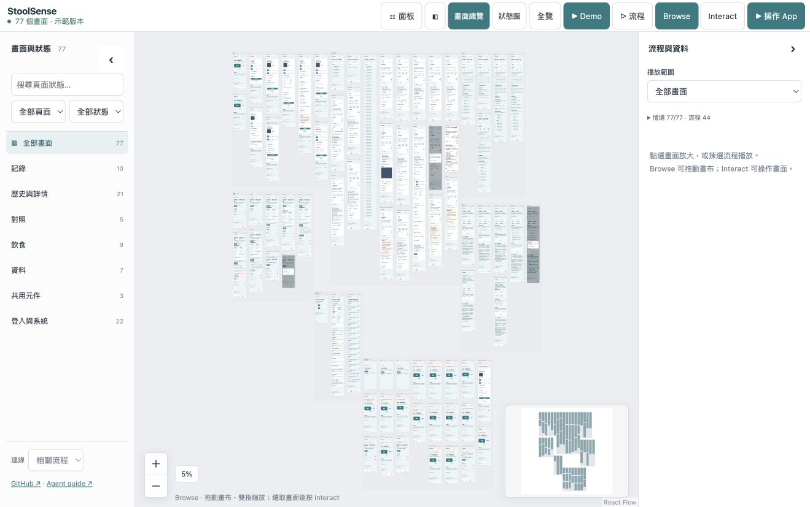
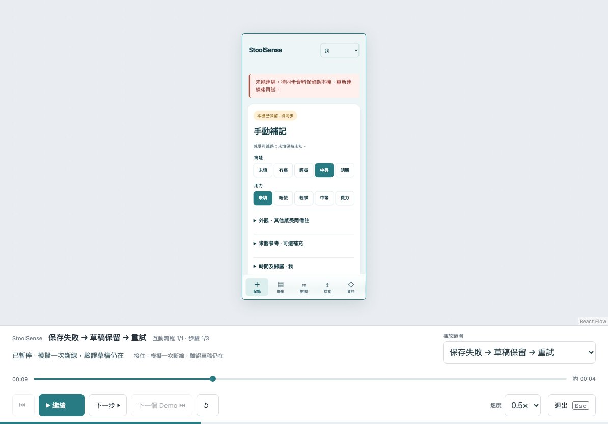

<!-- Generated from launch/locales/zh-CN.json; run npm run docs:generate. -->
# App Canvas

[English](README.md) · [繁體中文](README.zh-TW.md) · [简体中文](README.zh-CN.md) · [日本語](README.ja.md) · [Español](README.es.md) · [Français](README.fr.md) · [Deutsch](README.de.md) · [Português](README.pt.md) · [Italiano](README.it.md) · [한국어](README.ko.md) · [Nederlands](README.nl.md)

## 整个 UI，一张画布，来自真实代码。

与 coding agent 一起创建和维护可缩放画布，同时查看真实页面、状态和交互流程。

**[打开交互 Demo](https://tombelieber.github.io/app-canvas/) · [接入现有 Repo](https://tombelieber.github.io/app-canvas/about/zh-CN/start/) · [产品发布文章](https://tombelieber.github.io/app-canvas/about/zh-CN/release/)**

## TL;DR

- 一次看清已实现的完整页面、命名状态和连接流程。
- 只维护一份 UI。Coding agent 负责 fixtures、adapter 和 coverage checks。
- 公开合成数据 Demo 有 77 个状态和 44 条流程，无需登录或 API key。



公开 Demo 真实画面：77 个已编写状态、44 条流程、121 个可播放项目。队列包含独立 case，并非 121 条端到端流程。

## 看全貌、直接操作、播放流程

### 缩小，看清整个 App

按页面分组查看完整画面，搜索、筛选或收起侧栏。点击流程链接后，镜头会移动到目标画面。

### 放大，操作真实 UI

Browse 锁定控件，便于拖动画布。选中画面后点击 Interact，即可用合成数据操作原有 App 代码。

### 点击 Demo，展示完整旅程

在持续运行的 App session 中播放成功、失败和恢复流程，附操作提示、字幕、暂停、速度和步骤时间轴。



实际失败和恢复画面。播放会执行已编写操作与检查；画一条连线本身不等于测试。

## 从现有 Repo 到完整交互画布

交给能读写 Repo 并执行命令的 coding agent。无需事先准备 Storybook 或手写画面清单；仅安装包不会自动填满画布。

### 粘贴给你的 Coding Agent

```text
Read https://github.com/tombelieber/app-canvas/blob/v0.10.3/AGENT_GUIDE.md and add a completely populated App Canvas to this repository. Discover all screens, components, variants, states and navigation from the whole application source. Use original UI code. Create the missing synthetic fixtures and render harnesses. Reconcile an independent source inventory with rendered cases and source-linked runtime checks. Add checked happy, failure and recovery journeys. Run --complete against the original source root. Continue until the full landscape is populated and verified; report genuine blockers as incomplete. Keep production sessions, credentials and real user data out of previews.
```

### 1. 安装共享工具

使用 Node.js 22+，沿用项目的包管理器与 lockfile。安装固定版本的 GitHub release，再安装浏览器。npm 12 若阻止此直接 Git 依赖，才添加 --allow-git=root；无需更改全局设置。

```sh
npm install --save-dev github:tombelieber/app-canvas#v0.10.3
npx app-canvas browsers
```

### 2. 先盘点，再选择 Case

从整个 App 根目录运行 discover。Agent 逐一检查源代码区域和候选项，解决 pending，独立列出语义状态，不能反过来由 catalog 决定范围。未解决的 blocker 必须保留。

```sh
npx app-canvas discover --source-root . --out .artifacts/app-canvas/inventory.json
npx app-canvas pending --inventory .artifacts/app-canvas/inventory.json
```

### 3. 用 Fixtures 渲染原有 UI

Agent 创建 ui-review/canvas.config.mjs、catalog、合成 fixtures、preview entry 和可检查 journeys。Web adapter 导入原有页面、providers 与样式；fixtures 只替代数据和依赖，不能重写 UI。拒绝未知网络请求。

### 4. 验证状态和交互

覆盖已实现的正常、空白、加载、错误、拒绝访问、对话框和恢复状态。检查每个 case，流程要操作真实控件。核对 inventory、关联源码的 assertions 和 routes，再对同一 App 根目录通过 --complete。

```sh
npx app-canvas --config ui-review/canvas.config.mjs --check
npx app-canvas --config ui-review/canvas.config.mjs --verify
npx app-canvas --config ui-review/canvas.config.mjs --complete --source-root .
```

### 5. 从源代码维护和检查

运行 ui:review，查看总览和状态图，再播放流程。让 Agent 修改真正的 App 源码；既有 preview 会重新构建。新 route 或状态需要更新 inventory、fixture 和 journey，交付前必须通过完整检查。

```sh
npm run ui:review
```


### 哪些文件留在你的 App Repo

共享包维护 viewer、CLI 和 skill；各 Repo 维护自己的 adapter、fixtures、独立 inventory、catalog 和交互检查。从可运行的 React/Vite 示例开始；其他技术栈使用专属 adapter。

[Agent guide](https://github.com/tombelieber/app-canvas/blob/v0.10.3/AGENT_GUIDE.md) · [React/Vite](https://github.com/tombelieber/app-canvas/tree/v0.10.3/examples/react-vite)

### 可选的 Agent Skill

Codex 和 Claude Code 可以安装附带的 skill，其他 coding agent 可直接阅读 AGENT_GUIDE.md。Canvas runtime 不调用模型，也无需模型 API key；你选择的 Agent 有自己的费用和权限。

```sh
npx app-canvas install --target both
```

## 这个版本能证明什么，有哪些限制

- Web preview 使用真实 HTML/CSS，交互时执行原有 JavaScript。UIKit、SwiftUI 和 Android 需要原生 runtime harness 和证据；原生截图不等于可操作的原生 App。
- Coverage 是经过审查的源码与 case 对照，不会自动推断所有业务场景。UI checks 不代表 production backend、医疗准确率或模型 precision 已达标。
- Viewer 控制界面目前为繁体中文；产品页和教程提供多语言。公开 Demo 是固定的合成数据 frontend export，实际集成才监看你的源码。尚未测量实体 iPad 性能。

合成数据 Demo · 无 App backend · 无需登录 · 无需 API key

[Safari 优化实录](https://tomtang3.ai/blog/app-canvas-safari-rendering/)

完整 API、原生流程、替代工具和 release 维护，详见英文 README 和 Agent 指南。 [English README](README.md) · [MIT](LICENSE)
