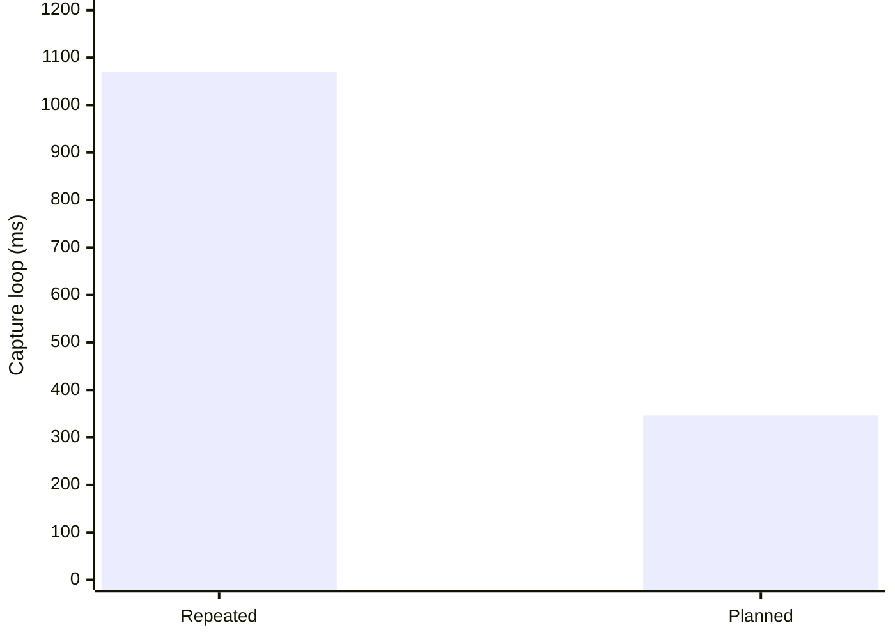

# Repeated capture work: 32 → 8, with all checks retained

A controlled original React app experiment reduced captures **75%** and median
capture-loop elapsed time **68%**, from **1,070ms to 346ms** on the final candidate. All 32 evidence labels
retained identical UI pixels. This measures redundant work avoided by planning;
it does not predict total time for a new application.

| Same completed workload | Repeated evidence captures | Planned shared captures |
| --- | ---: | ---: |
| Actual original UI states | 8 | 8 |
| Evidence labels retained | 32 | 32 |
| Screenshots/navigation cycles | 32 | 8 |
| Median elapsed time | 1,070ms | 346ms |



The previous pattern captures the same state again for each evidence label.
The planner groups exact equivalent source/build/state/fixture/viewport/lifetime
inputs, unions read-only observations and supplies one display surface with
retained evidence aliases. Different errors, layouts, locales, data or lifetimes
stay separate. Page/feature grouping uses the existing viewer hierarchy.

## Method and raw trials

The fresh packed package is installed into a disposable React/Vite app. Its
preview imports the original `src/App.jsx`, uses synthetic fetch boundaries,
and exposes both real routes and all eight visible states, including profile
loading and saved confirmation. The baseline and planned loop use the same
390×844 viewport, source/build/fixtures, checks and screenshots. Warm once,
then alternate the execution order across three trials. Compare screenshot
SHA-256 for every evidence label; all match exactly.

| Trial | Execution order | Repeated | Planned |
| --- | --- | ---: | ---: |
| 1 | Repeated, planned | 1,157.777ms | 346.343ms |
| 2 | Planned, repeated | 1,020.841ms | 348.859ms |
| 3 | Repeated, planned | 1,070.171ms | 304.748ms |

An earlier development run measured 847.316/266.791ms,
840.957/219.044ms and 895.443/197.728ms (repeated/planned), with medians
847/219ms: 74% reduction. The final run also had viewer regression suites
running in parallel. Keep both results: elapsed time varies with load; avoided
captures and retained checks are deterministic.

Reproduce from a tool checkout with Chromium installed:

```sh
APP_CANVAS_BENCHMARK_DIR="$PWD/.artifacts/ui-delivery-benchmark" npm run test:onboarding
```

The unaggregated JSON report is written under that directory. The [recorded final trials](ui-delivery-benchmark.json) are also committed. The implementation
and assertions live in [the benchmark](../tests/population-performance.browser.mjs)
and [packaged onboarding](../tests/onboarding.browser.mjs). The benchmark has no
speed threshold; correctness does not depend on winning a noisy timing sample.

## What is verified, and what is not

The installed CLI runs resumable preparation followed by the fresh independent
UI gate. A second invocation reuses intact preparation artifacts and reruns UI
verification. Omitted source UI, stale sources, wrong roots, missing assertions
and missing native accessories have red-capable checks. Original add, save,
retry and navigation actions run in continuing sessions. The separate existing
`--complete` remains strict and fails without its full source audit.

Executor checks cover dependency/output invalidation, interrupted resume,
unchanged failures, bounded commands, project ownership through final
verification and device resource exclusion across projects. Native GPU, original
React retained state, Demo/Play, graph/overview and flow links keep their existing
Chromium/WebKit regression gates.

This is a small synthetic app, not a native emulator benchmark or a
claim of universal 4× onboarding speed. It measures neither GPU memory nor FPS.
Whole-project discovery still needs the coding agent to inspect semantics and
actual navigation; syntax alone cannot prove every arbitrary application state.
The package supplies enforceable inventories, execution and evidence checks,
not an infallible state enumerator. These commands are available in v0.13.0 or later.


New large UI deliveries also start grouped: the 260-case browser fixture opens
with 20 visible page/feature representatives. All 260 cases remain addressable;
“All states”, search and cross-page links reveal them. Chromium and WebKit
checks keep retained original input and the continuing Demo intact. Existing
integrations keep their starting view. See [the grouping regression](../tests/grouping.browser.mjs).
